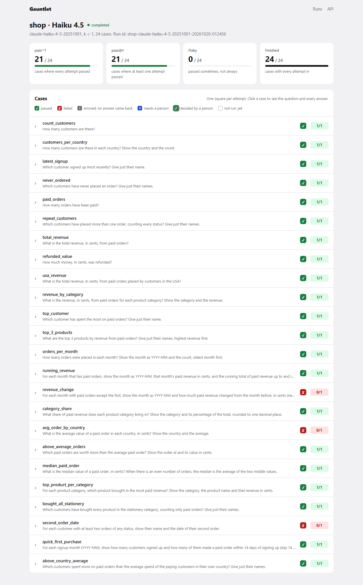
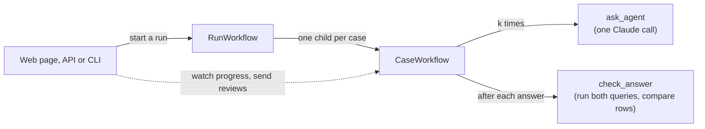

# Gauntlet

A durable eval runner for AI agents, built on [Temporal](https://temporal.io).

Gauntlet asks an agent every question in a test suite k times, checks each answer, and reports
**pass^k** (every attempt passed) next to **pass@k** (at least one attempt passed). Each run is a
Temporal workflow, so if a worker crashes, the run picks up where it stopped without asking the
agent again for answers it already has. Answers no check can decide wait for a person to review.

## Try it: the live demo and retries

You need Git, [uv](https://docs.astral.sh/uv/) and an Anthropic API key in `.env`. The full setup
is in [Run it locally](#run-it-locally).

```bash
uv sync
uv run gauntlet demo-db demo/shop.sql demo/shop.db   # build the demo database once
```

**The live demo.** One command starts a local Temporal server, a worker and the web app:

```bash
uv run --env-file .env gauntlet up
```

Open http://127.0.0.1:8000, tick Claude Haiku 5.5, set k = 2 and press Start. Temporal's own UI,
with every run's history, is at http://localhost:8233.

**Retries: stop the worker in the middle of a run.** Run the three parts in separate terminals
(this needs the [Temporal CLI](https://docs.temporal.io/cli/setup-cli)):

```bash
temporal server start-dev --db-filename temporal.db   # 1. Temporal
uv run --env-file .env gauntlet worker                # 2. the worker: Ctrl+C this one mid-run
uv run gauntlet web                                   # 3. the web app
```

1. Start a run on the web page.
2. While it runs, press Ctrl+C in terminal 2. The run page says no worker is answering.
3. Start the worker again. After about 10 to 20 seconds (a 6-second heartbeat timeout, then a
   10-second timeout on the stopped worker's own queue), the run carries on. Attempts that had
   already finished are not asked again.
4. In Temporal's UI, open one of the run's cases (`<run id>/<case id>`). The `ask_agent` that was cut
   off shows attempt 2.

Without the Temporal CLI, press Ctrl+C on `gauntlet up` instead and start it again. Everything
restarts, and the run resumes from `temporal.db`.

**Retries without an API key.** These tests use a fake agent:

```bash
uv run pytest tests/test_worker.py                                     # kills a real worker process mid-run (~20 s)
uv run pytest tests/test_workflows.py -k "not_retried or replays"     # agent errors are final; replay matches the history
uv run pytest tests/test_activities.py -k "heartbeat or not_retried"  # heartbeats; errors are not retried
```



*A real run: Claude Haiku 4.5, k = 1, on the demo suite. The three red cases are hard questions it
got wrong.*

## Why

- **Consistency, not best-of-k.** An agent that answers a question right 2 times out of 3 will
  answer it wrong for some users. pass@k hides that; pass^k shows it. The gap between them is the
  flaky cases.
- **Evals fail in boring ways.** Model calls time out and machines restart. Temporal records every
  finished attempt, retries calls that time out, and resumes a run after a crash, so finished work
  is never redone or paid for twice.
- **Some answers need a person.** A reply with no SQL in it can't be checked automatically. The
  case waits, for up to 7 days, until someone marks it passed or failed on the run page.

## How it works



- `RunWorkflow` starts one `CaseWorkflow` per question, all in parallel.
- `CaseWorkflow` asks the agent k times. Each answer goes through two activities:
  - `ask_agent` makes one Claude call. It heartbeats while it waits, has a 2-minute limit, and gets
    up to 3 tries if it times out.
  - `check_answer` runs the agent's SQL and the reference SQL on a read-only connection and compares
    the rows.
- The web app and the CLI are only Temporal clients. They start runs, read progress through a
  workflow query, and send a person's verdict through a workflow update. Restarting them loses
  nothing.

## The demo suite

The demo is a small shop database with customers, products, orders and order items
([demo/shop.sql](demo/shop.sql)). The suite has 24 questions ([demo/suite.json](demo/suite.json)):

- **13 basic questions:** counts, joins, grouping.
- **11 multi-step questions:** running totals, month-over-month change, a median (SQLite has
  none), "customers who bought *every* stationery product", signup cohorts and more.

Each hard question has a test proving that a common wrong query fails it. Examples are integer
division, or averaging item lines instead of whole orders.

The agents you can pick are Claude Haiku 5.5, Sonnet 5.5 and Opus 5.5, plus Haiku 4.5 as an
older baseline.

## Run it locally

You need [Git](https://git-scm.com/downloads), [uv](https://docs.astral.sh/uv/) (it installs
Python 3.13 for you) and an [Anthropic API key](https://console.anthropic.com/). Nothing else is
needed: Gauntlet downloads Temporal's local dev server itself.

### Set up (once)

These commands work in PowerShell and in a macOS or Linux terminal.

```bash
git clone https://github.com/Siddhant-Shankar/Gauntlet.git
cd Gauntlet
uv sync                                            # Python 3.13 and every package in uv.lock
cp .env.example .env                               # then paste your key after ANTHROPIC_API_KEY=
uv run gauntlet demo-db demo/shop.sql demo/shop.db # build the demo database
```

### Start everything with one command

```bash
uv run --env-file .env gauntlet up
```

This starts a local Temporal server, a worker and the web app together.

- **Gauntlet:** open http://127.0.0.1:8000, pick agents and k, and start a run.
- **Temporal's own UI:** http://localhost:8233.
- **Interactive API docs:** http://127.0.0.1:8000/docs.

Runs are saved in `temporal.db`, so they survive a restart. Finished runs are deleted after 24
hours. Ctrl+C stops everything.

Each run asks Claude once per question per attempt: 24 questions at k = 3 is 72 calls per agent.

### Start a run without the web page

With `gauntlet up` running, from PowerShell:

```powershell
Invoke-RestMethod -Method Post -Uri http://127.0.0.1:8000/api/runs -ContentType "application/json" `
  -Body '{"suite": "shop", "k": 3, "agents": ["claude-haiku-5-5", "claude-sonnet-5-5"]}'
```

or with curl:

```bash
curl -X POST http://127.0.0.1:8000/api/runs -H "Content-Type: application/json" \
  -d '{"suite": "shop", "k": 3, "agents": ["claude-haiku-5-5", "claude-sonnet-5-5"]}'
```

Or from the command line, which waits and prints a report:

```bash
uv run gauntlet run demo/suite.json --db demo/shop.db -k 3 --agent claude-haiku-5-5
```

### Try the crash demo

1. Start a run with k = 3.
2. While it runs, press Ctrl+C in the `gauntlet up` terminal. That stops Temporal, the worker and the
   web app mid-run.
3. Run `gauntlet up` again and reopen the run page. The run finishes, and the attempts that were
   already done are not asked again.

To crash only the worker, run the three parts in separate terminals instead. This needs the
[Temporal CLI](https://docs.temporal.io/cli/setup-cli):

```bash
temporal server start-dev --db-filename temporal.db   # 1. Temporal
uv run --env-file .env gauntlet worker                # 2. the worker: stop this one mid-run
uv run gauntlet web                                   # 3. the web app
```

### Review what no check could decide

An answer with no SQL in it shows a note box with **Mark passed** and **Mark failed** on the run
page.

## Project layout

| File | What it does |
|---|---|
| `src/gauntlet/models.py` | Every data model: cases, suites, outcomes, attempts, scores and the API's views |
| `src/gauntlet/sql_check.py` | Runs the agent's SQL read-only, with a time limit, and compares rows with the reference |
| `src/gauntlet/scoring.py` | pass^k and pass@k for a case and a suite |
| `src/gauntlet/agent.py` | The `Agent` interface, a scripted fake agent for tests, and SQL extraction from replies |
| `src/gauntlet/claude_agent.py` | The real agent: one Messages API call per question |
| `src/gauntlet/activities.py` | `load_schema`, `ask_agent` and `check_answer` |
| `src/gauntlet/workflows.py` | `RunWorkflow` and `CaseWorkflow`, including the review update |
| `src/gauntlet/worker.py` | Connects to Temporal and builds the worker |
| `src/gauntlet/runs.py` | Start, list, read and review runs; shared by the web app and the CLI |
| `src/gauntlet/web.py`, `static/` | The FastAPI app and its three pages: start, run and compare |
| `src/gauntlet/report.py` | The text report the CLI prints |
| `src/gauntlet/cli.py` | The `gauntlet` command: `up`, `demo-db`, `worker`, `run` and `web` |

## Development

```bash
uv run pytest
uv run mypy src tests
uv run ruff check .
uv run ruff format --check .
```
