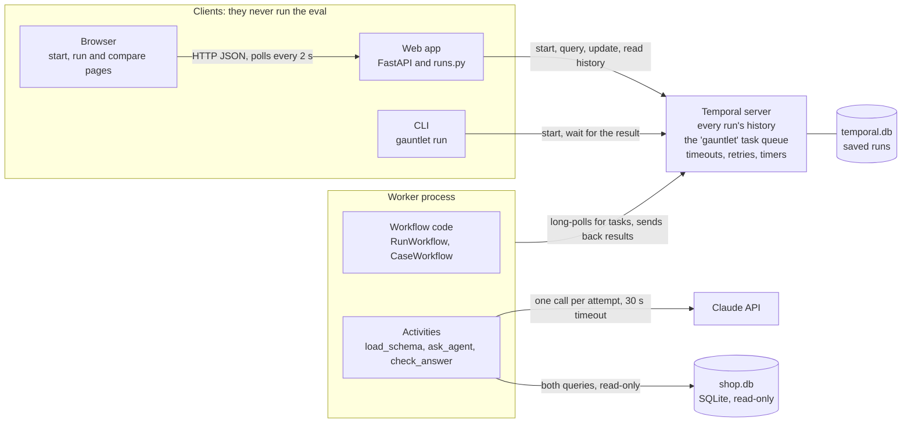
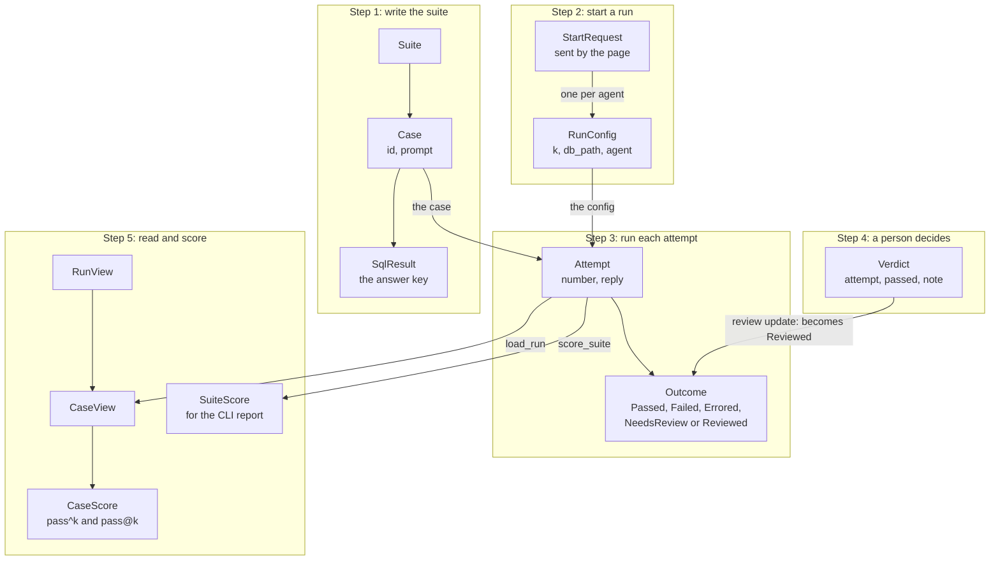
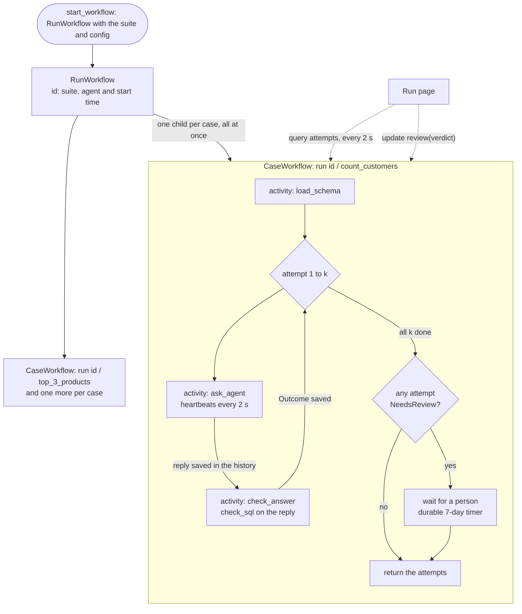
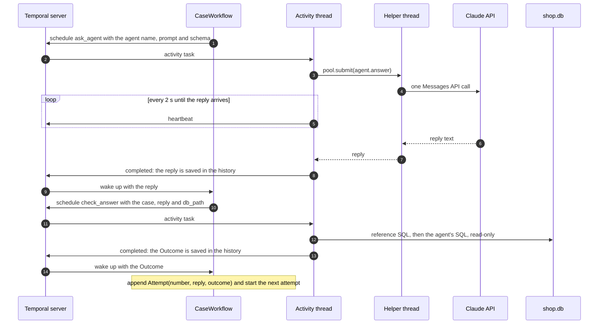
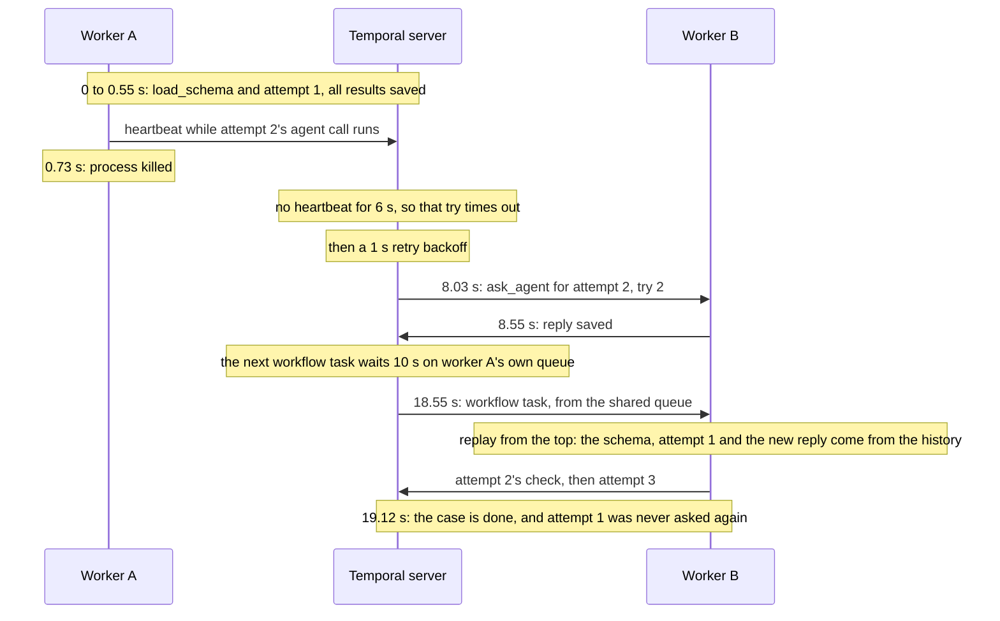
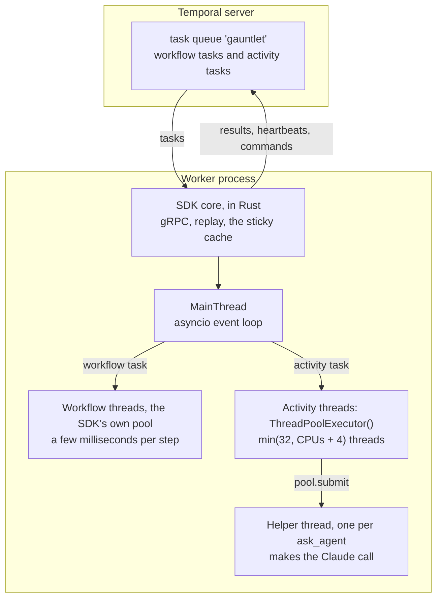

# Architecture

How Gauntlet is put together, in six diagrams. GitHub draws them from the Mermaid text below.

1. [Who talks to whom](#who-talks-to-whom)
2. [The models, in the order a run uses them](#the-models-in-the-order-a-run-uses-them)
3. [One run: a workflow per case](#one-run-a-workflow-per-case)
4. [One attempt, step by step](#one-attempt-step-by-step)
5. [A worker crashes mid-run](#a-worker-crashes-mid-run)
6. [Threads inside a worker](#threads-inside-a-worker)

## Who talks to whom

The web app and the CLI only talk to Temporal: they start runs, read them and send reviews. Only the
worker runs Gauntlet's code, and only its activities touch Claude or the database. Restarting the web
app loses nothing, because the Temporal server keeps every run.

## The models, in the order a run uses them

Every model is in `src/gauntlet/models.py` and is frozen. A box inside another is one of its fields.
Each arrow is labelled with the code that does the conversion.

## One run: a workflow per case

`RunWorkflow` starts one `CaseWorkflow` per question, all at once. Each child's id is the run id, a
slash and the case id, which is how the run page queries a case and how a review reaches it. Steps that
touch the outside world are activities, and the server saves each one's result in the case's history.

## One attempt, step by step

Asking and checking are two separate activities, so the agent's reply is saved before anything
judges it. If the check fails and is retried, the agent isn't asked again.

## A worker crashes mid-run

Recorded on 2026-10-20 with a slow fake agent and k = 3. Worker A was killed during attempt 2's agent
call, and worker B finished the case. `tests/test_worker.py` checks the same thing with a real process
kill.

## Threads inside a worker

A workflow that's waiting isn't on any thread: it's history on the server. Workflow code runs for a few
milliseconds at a time. Activities are plain functions, so each one holds an activity thread while it
runs, and `ask_agent` runs the Claude call on its own helper thread so the activity thread can keep
heartbeating.

**A known limit.** The worker doesn't cap how many activities it accepts at once. If more arrive than
there are activity threads, the extra ones wait for a thread without heartbeating, so the server times
them out and retries them. In a recorded test with 4 cases, 2 threads and a 7 s agent, that made 8 agent
calls instead of 4. Setting the worker's `max_concurrent_activities` to the thread pool's size would fix it.
